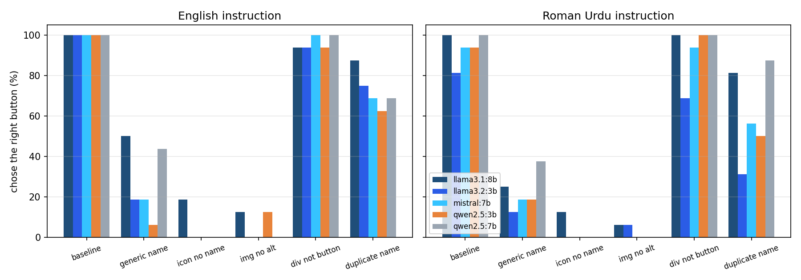

# A11yBridge: accessibility defects and small local LLM web agents

[](https://doi.org/10.5281/zenodo.24045501)
[](https://doi.org/10.5281/zenodo.24045414)

**Missing Names, Wrong Clicks: Accessibility Defects and Element Choice by Small Local LLM Web Agents**

Web agents often read a page through its accessibility tree, the same list of roles and names that a screen reader uses. This repository measures what happens to small local language models acting as web agents when the control they need has an accessibility defect: no name, a generic name, a missing label, or no proper role.

## Research questions
1. How often does a small local model choose the right element when the target control has an accessibility defect, compared with the same page without the defect?
2. When it fails, does it pick a risky look-alike (for example "Delete report" instead of "Save report"), another control, or say the control is not there?
3. Does the user's language matter: the same task written in English or in Roman Urdu, on an English page?
4. How does the model compare with a fixed role-and-name script, which fails by design on every renamed control?

## Design
| Part | Choice |
|---|---|
| Pages | 16 tasks on fictional clinic pages (8 buttons, 4 links, 4 text fields) x element-specific defects x 2 layouts = 168 pages (`agent_study/pages.py`). Each page has one target, one risky look-alike (buttons and links) and two neutral controls. |
| Defects | Buttons: generic name ("Action"), icon with no name, image with no alt text, `div` instead of `button`, a duplicate name in another section. Links: generic name ("Click here"), image with no alt, `span` instead of `a`, duplicate name. Text fields: label not linked, placeholder only, no label. |
| Observation | Chromium renders each page with Playwright; the model sees the page's ARIA snapshot as numbered lines. The code records which line is the target, the risky look-alike or another control. |
| Task | One step: reply with the line number to act on, or 0 if nothing fits. English and Roman Urdu instructions. |
| Models | `qwen2.5:3b`, `llama3.2:3b`, `qwen2.5:7b`, `mistral:7b`, `llama3.1:8b` through Ollama, temperature 0, seed 42: 336 calls each, 1,680 in total. |
| Outcomes | right element, risky look-alike, other wrong element, said none, invalid reply. |
| Statistics | Paired differences against the same task and layout without the defect, with bootstrap 95% intervals (2,000 resamples). |
| Script reference | The exact role-and-name locator from version 0.2.0, computed on every page. |

## Run (MacBook, Ollama open)
```bash
python3 -m venv .venv && source .venv/bin/activate
pip install -r requirements-dev.txt && python -m playwright install chromium
python -m pytest -q
caffeinate -i python -m agent_study.run       # about 1 to 2 hours, resumable
python -m agent_study.analysis                # tables and figure, no model needed
```

## Outputs
- `agent_study/results/pages.jsonl`: every page with its HTML, numbered tree and line labels.
- `agent_study/results/agent_runs.jsonl`: every call with the reply, chosen line and outcome.
- `agent_study/results/tables.md`, `results.json`, `fig_buttons.png`.

## Results
Run on 6 November 2026: 1,680 calls, none failed. Full tables in [`agent_study/results/tables.md`](agent_study/results/tables.md); paper draft in [`paper/`](paper/).

| Element | Condition | Right element | Risky look-alike | Said none | Exact script |
|---|---|---|---|---|---|
| Button | baseline | 96.9% | 1.2% | 0.0% | 100% |
| Button | `div`, not `button` | 94.4% | 0.0% | 0.6% | 0% |
| Button | generic name | 25.0% | 10.6% | 35.6% | 0% |
| Button | icon, no name | 3.1% | 11.9% | 44.4% | 0% |
| Button | image, no alt | 3.8% | 9.4% | 41.9% | 0% |
| Link | baseline | 86.2% | 2.5% | 1.2% | 100% |
| Link | generic name | 3.8% | 1.2% | 35.0% | 0% |
| Text field | no label | 16.2% | - | 46.2% | 0% |

Pooled over five models and English and Roman Urdu instructions. Unnamed controls were almost never chosen, and in about one run in ten the model picked the risky look-alike (for example "Delete report" for "Save the report"). Controls with the right visible text but the wrong role were still found, although the exact script failed on all of them.



## Limitations
- Fictional pages written by one person, with one defect at a time; real pages have many defects together.
- One-step element choice, not a full multi-step agent; the model sees only the accessibility tree, not the screen.
- Small open models with default quantisation, one answer per page at temperature 0.
- An agent's success is not evidence that a page is usable for people who rely on assistive technology.

## Earlier version
Version 0.2.0 ran a fixed exact role-and-name locator on three page pairs (`a11ybridge/`, `run_experiment.py`, `results_v0_2_0_final/`). Its 100% vs 0% result follows from the design, because the defect pages rename the control the locator looks for; it is kept as the script reference above.

## Citation
```bibtex
@misc{hussain2026a11ybridge,
  author    = {Hussain, Muzammal},
  title     = {Missing Names, Wrong Clicks: Accessibility Defects and Element Choice by Small Local {LLM} Web Agents},
  year      = {2026},
  publisher = {Zenodo},
  doi       = {10.5281/zenodo.24045501},
  note      = {Preprint}
}
```
Software: [doi:10.5281/zenodo.24045414](https://doi.org/10.5281/zenodo.24045414); see also [`CITATION.cff`](CITATION.cff).

## Licence
MIT. See `LICENSE`.
